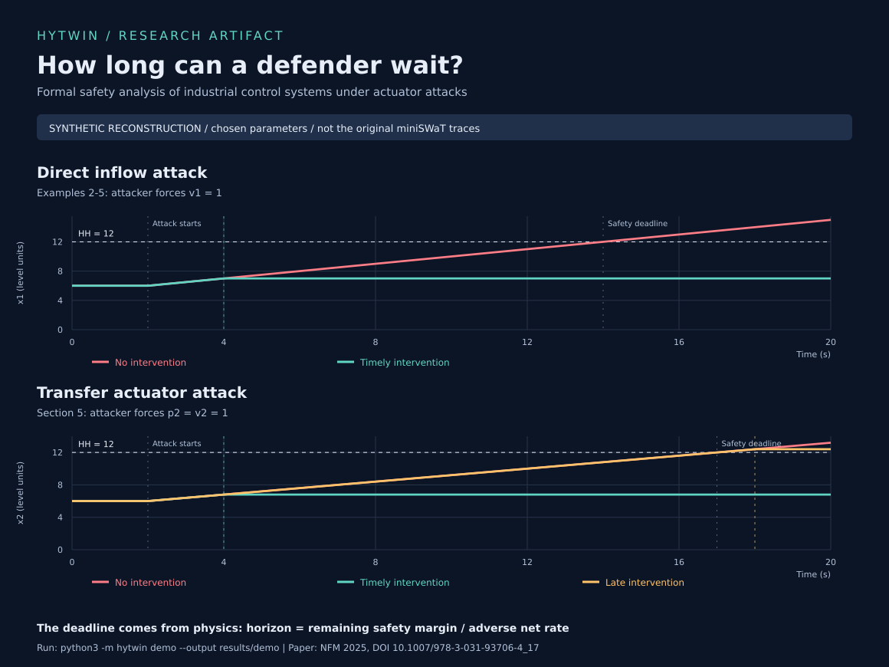
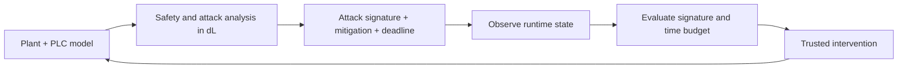

# HyTwin

### Formal Safety Analysis and Timed Security Interventions for Industrial Cyber-Physical Systems

**When must a digital twin intervene to keep a physical process safe under attack?**

**HyTwin connects formal verification with experimental CPS security.** It brings together adversarial hybrid-system models, safety-preserving interventions, and trace-based evaluation on a PLC-driven water-treatment testbed. Its central idea is the **mitigation horizon**: the time available to act before a safety condition can no longer be preserved by the modeled mitigation.

Research artifact for **[HyTwin: Hybrid Program Semantics for Digital Twin-Based Security Interventions in Industrial Control Systems](https://doi.org/10.1007/978-3-031-93706-4_17)**, Jainta Paul, Stefan Mitsch, and Luis Garcia, **NASA Formal Methods (NFM 2025)**. [Author PDF](https://facweb.cdm.depaul.edu/smitsch/pdf/nfm25-hytwin.pdf) · [Paper-to-artifact map](docs/paper-map.md) · [Formal models and proofs](docs/formal-models.md) · [Research showcase](docs/showcase.md)

**Experimental trace collection and validation:** the companion **[OpenPLC Mini Water Treatment Testbed](https://github.com/iotrustlab/miniwatertreatment/tree/main)** was used to **collect and validate the process traces for HyTwin's water-treatment evaluation**. Together, the repositories connect mathematical attack models and intervention deadlines to instrumented PLC experiments. [Explore the experimental infrastructure](docs/experimental-testbed.md).



## Evidence you can inspect

- **PLC-based experimental foundation:** the companion [miniwatertreatment repository](https://github.com/iotrustlab/miniwatertreatment/tree/main) provides OpenPLC controller projects, physical I/O integration, attack scripts, and multi-PLC trace collection tooling used in the trace collection and validation workflow.
- **Nine newly reconstructed, machine-checked dL obligations**, including unbounded nominal two-tank safety, attack/monitor properties, and fixed-flow horizon/shutdown properties. KeYmaera X 5.1.2 + Z3; [source, logs, generated lemmas, and checksums](results/proofs/).
- **A dependency-free executable demonstration**: six scenarios, exact constant-rate evolution within each scan, a response-delay sweep, and CSV/JSON/SVG outputs.
- **44 original historical files recovered from Git**, preserved with commit IDs and SHA-256 hashes. These include attack models, Structured Text, process prototypes, and historical logs. [Recovery record](docs/history-recovery.md).
- **Explicit provenance** separating surviving originals, recovered drafts, new reconstructions, and missing experimental evidence.

**Artifact status:** the experimental collection and validation infrastructure is available in the [companion testbed repository](https://github.com/iotrustlab/miniwatertreatment/tree/main). The exact original Figure 2/3 recordings and original proof-session exports are not included in this HyTwin checkout. This repository combines historical material with new reconstructed proofs and a synthetic demonstration. The new proofs certify their written models under explicit assumptions; deployed hardware safety and the complete abstract shield theorem remain outside their scope.

## From formal reasoning to experimental traces

The research connects three levels of evidence: **attack and plant models**, **machine-checked safety reasoning**, and **experimental process traces**. The [companion testbed](https://github.com/iotrustlab/miniwatertreatment/tree/main) supplies the PLC and instrumentation context for collecting and validating those traces, while HyTwin formalizes the relationship between adversarial behavior, physical safety, and the deadline for intervention.

The experimental infrastructure includes [PLC1](https://github.com/iotrustlab/miniwatertreatment/tree/main/PLC1), [PLC2](https://github.com/iotrustlab/miniwatertreatment/tree/main/PLC2), and [PLC3](https://github.com/iotrustlab/miniwatertreatment/tree/main/PLC3) controller projects, [attack scenarios](https://github.com/iotrustlab/miniwatertreatment/tree/main/Attacks), and [trace generators](https://github.com/iotrustlab/miniwatertreatment/tree/main/TraceGenerators). Its [multi-PLC collector](https://github.com/iotrustlab/miniwatertreatment/blob/main/TraceGenerators/master_plc_monitor.py) records timestamped sensor measurements and actuator states through Modbus TCP. This makes the work relevant to both **formal methods research** and **experimental industrial security engineering**.

## Run the demonstration

From the repository root, using **Python 3.10+**:

```bash
python3 -m hytwin demo --output results/demo
bash check_all.sh
```

No pip packages, datasets, Docker, MATLAB, Wolfram account, or hardware are required for this path. `bash setup.sh` also generates the demo. Checked-in outputs are available for inspection without running anything.

| Scenario | Behavior | Outcome with chosen demo parameters |
| --- | --- | --- |
| `nominal` | Paper Example 1 controller, no attack | Safe |
| `direct-unmitigated` | Force first inflow valve `v1=1` | Overflow after boundary at 14 s |
| `direct-mitigated` | Same attack; trusted shutdown after 2 s | Safe |
| `transfer-unmitigated` | Force transfer pump and valve `p2=v2=1` | Overflow after boundary at 17 s |
| `transfer-mitigated` | Same attack; trusted shutdown after 2 s | Safe |
| `transfer-late` | Same attack; shutdown after 16 s | Safety violation before shutdown |

Both attacks start at 2 s. Closed level bounds make boundary contact safe; continuing adverse flow beyond the boundary violates safety. Shutdown freezes the current levels, so acting late cannot undo an earlier violation.

Explore the response deadline yourself:

```bash
python3 -m hytwin run --attack transfer --delay 15 --output results/local/on-boundary
python3 -m hytwin run --attack transfer --delay 15.01 --output results/local/too-late
```

The first stays safe in this ideal model. The second waits until the next 0.25 s scan and violates safety. [Timing, assumptions, schema, and exact expected results](docs/reproducing.md).

## Replay the formal proofs

With Java 17+ and Linux/Bash tools:

```bash
bash scripts/check_models.sh --download --prove
```

This downloads the official pinned KeYmaera X 5.1.2 JAR, validates its checksum, and replays all nine new proofs using bundled Z3. With an existing JAR, set `KEYMAERAX_JAR=/absolute/path/keymaerax-5.1.2.jar` and omit `--download`. Fresh results go to `results/proofs/local/`.

| Formal artifact | Checked scope |
| --- | --- |
| [Nominal tank](models/water_tank.kyx) | Two-tank loop safety, nondeterministic bounded flows and scan durations |
| [Attack and mitigation](models/attack_mitigation.kyx) | Five actuator, monitor, and bounded sensor-spoof obligations |
| [Mitigation horizon](models/mitigation_horizon.kyx) | Three constant-flow horizon, maximality, and on-time shutdown obligations |

The [formal-model guide](docs/formal-models.md) states assumptions and transcription corrections and distinguishes positive signature matches from complete attack coverage. A matching actuator command can also occur benignly. The executable demo schedules response from a known injected attack window and signature observation; it is not an intrusion-detection benchmark or an automatically synthesized ModelPlex monitor.

## How the pieces connect



The paper's first-valve running example and its transfer-pump hardware experiment are distinct cases. This reconstruction keeps their models and demo names separate. For constant adverse level rate `q>0` with no effective outflow, the simple horizon witness is `tau=(HH-x0)/q`. Variable flows, lower-bound hazards, actuation delays, and model mismatch require additional analysis.

## Repository guide

| Path | Purpose |
| --- | --- |
| [`hytwin/`](hytwin/) | New Python model, scenario runner, and report generation |
| [`models/`](models/) | New dL models and replayable tactics |
| [`results/demo/`](results/demo/) | Synthetic traces, summary, 81-point delay sweep, overview, hash manifest |
| [`results/proofs/`](results/proofs/) | Checked proof evidence and verification metadata |
| [`tests/`](tests/) | Physical invariants, timing boundaries, failure cases, and evidence integrity |
| [`docs/paper-map.md`](docs/paper-map.md) | Exact mapping to paper definitions, examples, and figures |
| [`docs/experimental-testbed.md`](docs/experimental-testbed.md) | Companion PLC testbed used for experimental trace collection and validation |
| [`docs/showcase.md`](docs/showcase.md) | Portfolio framing, resume language, and interview walkthrough |
| [`legacy/recovered/`](legacy/recovered/) | Original deleted files restored byte-for-byte with provenance |
| [`Archive/securityformalization.kyx`](Archive/securityformalization.kyx) | Surviving original draft, unchanged |
| [`scadman_monitor_swat.py`](scadman_monitor_swat.py) | Surviving exploratory monitor, unchanged; not part of validated demo |

The previous Docker/Wolfram setup is preserved in [`legacy/`](legacy/README.md). The root Dockerfile runs only the new portable demo:

```bash
docker build -t hytwin-demo .
mkdir -p results/local/container
docker run --rm -v "$PWD/results/local/container:/results" hytwin-demo
```

## Research use and attribution

For a research audience, frame this as **formal verification and experimental validation of timed security interventions for industrial CPS**. The differentiator is connecting an attack's physical consequences to a model-derived intervention deadline, backed by an instrumented water-treatment research platform. Use the [showcase guide](docs/showcase.md) for a project description, resume bullets, and a three-minute technical walkthrough.

The most valuable extensions are to package experiment-specific traces and configurations alongside the available testbed infrastructure, prove monitor coverage for a richer attack class, and incorporate bounded sensing and actuation delay. Each would extend a concrete boundary of the present evidence.

Citation metadata is in [`CITATION.cff`](CITATION.cff). Preserve original author credits and any file-level third-party notices. No new blanket license is assigned to the historical multi-author material in this reconstruction.
